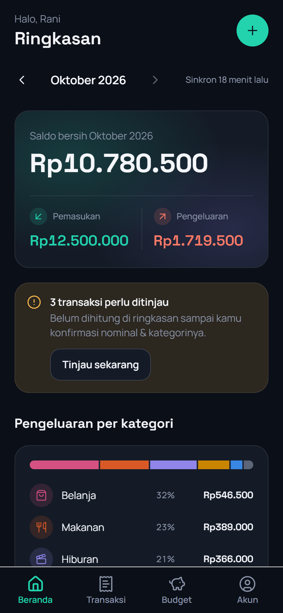
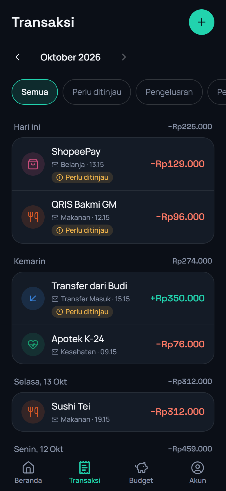
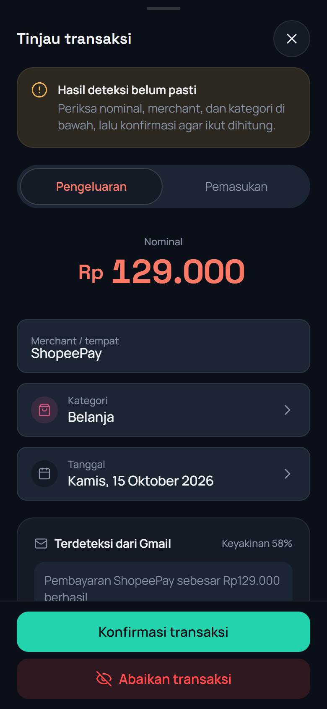
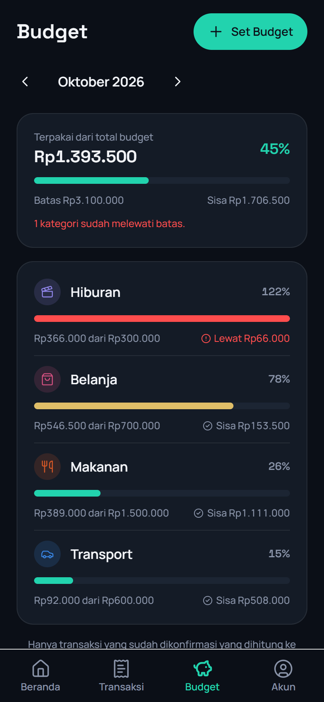

# BudgetMail

Catat pengeluaran tanpa input manual. BudgetMail membaca email notifikasi transaksi dari bank dan e-wallet (BCA, Mandiri, BRI, BNI, GoPay, OVO, DANA, ShopeePay) di Gmail-mu, lalu menyusunnya jadi daftar transaksi dan ringkasan bulanan. Budget per kategori bisa diset sendiri.

Izin Gmail-nya baca-saja (`gmail.readonly`), dan yang dibaca cuma email dari pengirim bank/e-wallet yang ada di allowlist. Password bank tidak pernah diminta.

Sebelum mengubah apa pun, baca dulu dokumen di `docs/`:

- [`docs/PRD.md`](docs/PRD.md): masalah, scope, keputusan teknologi, risiko Gmail/CASA
- [`docs/TASKS.md`](docs/TASKS.md): rencana per fase beserta statusnya
- [`docs/Design.md`](docs/Design.md): arah visual dan design token

## Tampilan

Semua tangkapan layar ada di [`docs/screenshots/`](docs/screenshots/). Diambil dari build web di ukuran HP (390×844) dengan data demo.

<p>
  
  
  
  
</p>

| File                               | Isi                                                     |
| ---------------------------------- | ------------------------------------------------------- |
| `01-login.png`                     | Login dengan Google                                     |
| `02-onboarding-gmail.png`          | Penjelasan izin Gmail sebelum connect                   |
| `03-beranda.png`                   | Saldo bersih, pemasukan/pengeluaran, breakdown kategori |
| `04-notifikasi-transaksi-baru.png` | Toast saat sync membawa transaksi baru                  |
| `05-transaksi.png`                 | Daftar transaksi per hari                               |
| `06-perlu-ditinjau.png`            | Filter transaksi yang menunggu konfirmasi               |
| `07-tinjau-transaksi.png`          | Detail transaksi dari Gmail beserta cuplikan email-nya  |
| `08-tambah-transaksi.png`          | Input transaksi manual                                  |
| `09-pilih-kategori.png`            | Picker kategori                                         |
| `10-budget.png`                    | Progres budget per kategori                             |
| `11-atur-budget.png`               | Set batas budget                                        |
| `12-akun.png`                      | Status koneksi Gmail dan catatan privasi                |

## Isi repo

Monorepo pnpm dengan tiga paket:

```
apps/
  backend/        API Fastify + worker BullMQ (TypeScript, Prisma, PostgreSQL, Redis)
  mobile/         Aplikasi React Native (Expo SDK 57, Expo Router)
packages/
  shared-types/   Tipe DTO yang dipakai bersama backend dan mobile
```

Backend-nya modular monolith. Kode per domain ada di `apps/backend/src/modules/` (`auth`, `gmail-sync`, `parsing`, `categories`, `transactions`, `budgets`, `dashboard`), dan semua dependency dirakit di `src/container.ts`. Aturan arsitekturnya ada di [`apps/backend/ARCHITECTURE.md`](apps/backend/ARCHITECTURE.md).

Alur datanya begini. Worker sync menarik ID email dari Gmail tiap 30 menit, plus backfill 3 bulan saat pertama kali connect. Tiap email jadi satu job parsing. Parser default-nya regex/heuristik tanpa API eksternal; kalau `ANTHROPIC_API_KEY` diisi, ekstraksi dikerjakan Claude. Hasil yang confidence-nya rendah masuk `pending_review` dan baru ikut dihitung setelah user mengonfirmasi.

Satu catatan: alamat pengirim di allowlist (`apps/backend/src/modules/parsing/senderAllowlist.ts`) sebagian besar masih berbasis domain bank dan belum dicocokkan dengan inbox asli. Jadi akurasi parser di dunia nyata belum diketahui.

## Yang dibutuhkan

- Node.js 20 atau lebih baru
- pnpm 11 (cukup `corepack enable`, versinya sudah dikunci di `package.json`)
- Docker, untuk PostgreSQL dan Redis lokal
- Project Google Cloud dengan OAuth consent screen berstatus Testing dan Gmail API aktif. Langkahnya ada di `docs/TASKS.md` bagian Fase 0.
- Untuk mobile: Expo Go atau emulator Android/iOS

## Setup

```bash
pnpm install
docker compose up -d
```

Postgres jalan di port 5434, bukan 5432, karena 5432 dan 5433 di mesin dev sudah dipakai Postgres lokal. Redis di 6379.

### Backend

Salin `apps/backend/.env.example` jadi `apps/backend/.env`, lalu isi:

| Variabel                                   | Isi                                                                                                                          |
| ------------------------------------------ | ---------------------------------------------------------------------------------------------------------------------------- |
| `DATABASE_URL`, `REDIS_URL`                | Default-nya sudah cocok dengan `docker-compose.yml`                                                                          |
| `GOOGLE_CLIENT_ID`, `GOOGLE_CLIENT_SECRET` | OAuth client (Web application) dari Google Cloud Console                                                                     |
| `PUBLIC_BASE_URL`                          | URL backend yang bisa dijangkau Google. Redirect URI `${PUBLIC_BASE_URL}/gmail/callback` harus didaftarkan persis di Console |
| `JWT_SECRET`                               | String acak minimal 32 karakter                                                                                              |
| `TOKEN_ENCRYPTION_KEY`                     | Kunci 32 byte base64 untuk mengenkripsi refresh token Gmail: `openssl rand -base64 32`                                       |
| `ANTHROPIC_API_KEY`                        | Opsional. Kosongkan untuk memakai parser rule-based                                                                          |

Lalu jalankan migration. Kategori default (Makanan, Transport, Belanja, dan seterusnya) ikut dibuat di sini.

```bash
pnpm --filter @budgetmail/backend exec prisma migrate dev
```

### Mobile

Buat `apps/mobile/.env`:

```
EXPO_PUBLIC_GOOGLE_CLIENT_ID=<client id Google yang sama dengan backend>
```

Aplikasi juga perlu tahu alamat backend. Di HP atau emulator, `localhost` menunjuk ke perangkat itu sendiri, jadi pakai IP LAN laptopmu (di emulator Android: `10.0.2.2`). Isi `expo.extra.apiBaseUrl` di `apps/mobile/app.json`, atau pakai env:

```
EXPO_PUBLIC_API_BASE_URL=http://192.168.1.10:3000
```

## Menjalankan

API dan worker jalan sebagai dua proses terpisah, jadi totalnya tiga terminal:

```bash
pnpm --filter @budgetmail/backend dev          # API di port 3000
pnpm --filter @budgetmail/backend worker:dev   # worker sync Gmail + parsing
pnpm --filter @budgetmail/mobile dev           # Metro / Expo
```

`pnpm dev` di root menyalakan API dan Expo sekaligus, tapi worker tetap harus dijalankan sendiri. Tanpa worker, tidak ada transaksi Gmail yang masuk.

Untuk memastikan backend hidup: `curl http://localhost:3000/health`.

Versi web (`pnpm --filter @budgetmail/mobile web`) cuma untuk preview waktu development. Web tidak punya SecureStore, jadi build produksi web sengaja tidak menyimpan sesi sama sekali.

## Tes dan pengecekan

```bash
pnpm --filter @budgetmail/backend test   # Vitest, tidak butuh Postgres/Redis
pnpm typecheck                           # semua paket
pnpm lint
pnpm format:check
```

Tes backend jalan di atas repository in-memory (`apps/backend/src/testing/fakes.ts`), termasuk tes route untuk auth, validasi, dan memastikan user tidak bisa mengakses data user lain. Mobile belum punya test runner.

## API

Kecuali `/health`, `/auth/google`, dan `/gmail/callback`, semua endpoint butuh header `Authorization: Bearer <jwt>`. Error dikembalikan sebagai `{ "error": "..." }`. Bulan ditulis `YYYY-MM`, dan batas bulannya dihitung dalam WIB.

| Endpoint                              | Fungsi                                                                                        |
| ------------------------------------- | --------------------------------------------------------------------------------------------- |
| `POST /auth/google`                   | Tukar Google ID token jadi sesi JWT                                                           |
| `GET /auth/me`                        | User yang sedang login                                                                        |
| `POST /gmail/connect`                 | URL consent Google untuk `gmail.readonly`                                                     |
| `GET /gmail/callback`                 | Callback OAuth dari Google, lalu redirect ke `budgetmail://gmail-connected`                   |
| `GET /gmail/status`                   | Status koneksi dan sync terakhir                                                              |
| `POST /gmail/sync`                    | Minta sync manual                                                                             |
| `DELETE /gmail/disconnect`            | Cabut token di Google dan hapus koneksi                                                       |
| `GET /transactions`                   | Daftar per bulan, filter `category`, `status`, `type`, pagination `cursor` + `limit`          |
| `GET /transactions/:id`               | Detail, termasuk cuplikan email untuk transaksi yang masih ditinjau                           |
| `POST /transactions`                  | Tambah transaksi manual                                                                       |
| `PATCH /transactions/:id`             | Ubah nominal, merchant, kategori, tanggal, tipe, status                                       |
| `DELETE /transactions/:id`            | Hapus transaksi manual. Transaksi dari Gmail ditandai `ignored` supaya tidak diimpor ulang    |
| `GET /categories`, `POST /categories` | Kategori default + milik user, tambah kategori                                                |
| `GET /budgets?month=`                 | Budget bulan itu beserta progresnya                                                           |
| `POST /budgets`                       | Set atau ubah budget per kategori per bulan                                                   |
| `POST /budgets/copy`                  | Salin budget dari bulan lain                                                                  |
| `DELETE /budgets/:id`                 | Hapus budget                                                                                  |
| `GET /dashboard/summary?month=`       | Pemasukan, pengeluaran, saldo, breakdown kategori, jumlah yang perlu ditinjau, progres budget |

Dashboard dan progres budget hanya menghitung transaksi `confirmed`. Yang masih `pending_review` muncul sebagai jumlah yang perlu ditinjau.

## Keamanan dan privasi

- Refresh token Gmail dienkripsi AES-256-GCM sebelum disimpan, dan tidak pernah muncul di log.
- Email diambil dengan `format: "metadata"`, jadi body email tidak pernah ikut terambil.
- Cuplikan email (`raw_snippet`) cuma disimpan selama transaksi masih `pending_review`. Begitu dikonfirmasi atau diabaikan, cuplikannya dihapus.
- Selama OAuth consent screen masih berstatus Testing, test user dibatasi 100 orang. Untuk rilis publik, Google mewajibkan verifikasi dan CASA assessment (lihat PRD §7), dan prosesnya bisa makan waktu berminggu-minggu.

## Status

Kode untuk Fase 0 sampai 5 sudah selesai (detailnya di `docs/TASKS.md`). Yang tersisa harus dikerjakan manual:

- Daftarkan test user di Google Cloud Console, lalu coba login dan connect Gmail di HP sungguhan. Alur ini belum pernah dites end-to-end.
- Pakai dengan Gmail asli selama satu atau dua minggu, lalu tuning threshold confidence parsing berdasarkan hasilnya.
- Fase 6 (privacy policy, verifikasi Google, CASA) sebelum rilis publik.
