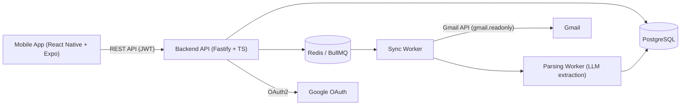

# PRD — Aplikasi Budgeting Otomatis via Gmail
**Working title:** BudgetMail (ganti sesuai selera)
**Versi:** 1.0 — MVP
**Tanggal:** 2 Juli 2026

---

## 1. Ringkasan Produk

Aplikasi mobile budgeting yang menghubungkan akun Gmail pengguna untuk secara otomatis mendeteksi dan mengekstrak transaksi (pemasukan & pengeluaran) dari email notifikasi bank/e-wallet, sehingga pengguna tidak perlu mencatat transaksi secara manual. Pengguna cukup menghubungkan Gmail sekali, lalu aplikasi menampilkan dashboard pemasukan/pengeluaran dan progres budget bulanan secara otomatis.

**Value proposition inti:** *"Catat pengeluaranmu tanpa mencatat apa-apa."*

## 2. Problem Statement

Pengguna yang ingin mengatur keuangan pribadi umumnya harus mencatat setiap transaksi secara manual di aplikasi budgeting — proses yang membosankan sehingga sering ditinggalkan setelah beberapa minggu. Padahal, hampir semua notifikasi transaksi bank dan e-wallet di Indonesia (BCA, Mandiri, BRI, GoPay, OVO, DANA, dll.) sudah otomatis masuk ke email. Data ini sudah ada, hanya belum dimanfaatkan. Akibatnya orang kehilangan visibilitas atas pola pengeluarannya dan sulit membuat budget yang realistis.

## 3. Target User

- **Primary persona:** Individu usia 22–35 tahun, sudah punya penghasilan tetap/freelance, aktif menggunakan m-banking/e-wallet, ingin mulai mengatur keuangan tapi malas input manual.
- **Asumsi:** Fase awal difokuskan ke pengguna Indonesia dengan akun Gmail pribadi (bukan Google Workspace kantor), karena pola notifikasi bank/e-wallet yang dijadikan acuan parsing adalah pola Indonesia.

## 4. Goals (Terukur)

| # | Goal | Metrik |
|---|------|--------|
| G1 | Pengguna baru mendapatkan value dalam <5 menit | Waktu dari connect Gmail → transaksi pertama tampil di dashboard |
| G2 | Parsing otomatis cukup akurat untuk dipercaya | ≥80% transaksi hasil parsing tidak perlu diedit manual oleh user |
| G3 | Mengurangi friksi pencatatan manual | ≤20% transaksi di aplikasi berasal dari input manual (sisanya otomatis dari Gmail) |
| G4 | Retensi awal sehat | ≥40% pengguna yang connect Gmail masih membuka app di minggu ke-4 |

## 5. Non-Goals (v1)

| Non-goal | Alasan |
|---|---|
| Integrasi langsung ke API bank (Open Banking) | Kompleksitas kepatuhan tinggi, belum perlu — email sudah cukup untuk validasi ide |
| Dukungan email provider selain Gmail (Outlook, Yahoo) | Fokuskan effort dulu ke satu provider sampai parsing terbukti akurat |
| Multi-currency | Target awal pasar Indonesia, semua transaksi diasumsikan IDR |
| Shared/family budget | Kompleksitas permission & data sharing, bukan kebutuhan inti MVP |
| Investment/aset tracking | Domain berbeda dari budgeting harian |
| OCR struk fisik | Sumber data MVP murni dari email, bukan foto |
| Aplikasi **tidak pernah** meminta password/kredensial bank — hanya membaca notifikasi email | Batas keamanan yang harus dijaga ketat sejak desain awal |

## 6. Keputusan Teknologi Utama

### 6.1 Frontend: **React Native (dengan Expo)** — bukan Flutter

Karena kamu sudah menetapkan backend di **TypeScript**, rekomendasinya adalah **React Native**, dengan pertimbangan berikut:

| Faktor | React Native | Flutter |
|---|---|---|
| Bahasa | TypeScript — **sama dengan backend** | Dart — bahasa terpisah |
| Sharing code/types dengan backend | Bisa share types (DTO, validasi) dalam satu monorepo | Tidak bisa, perlu duplikasi struktur data |
| Kecepatan MVP untuk dev yang sudah pakai TS | Lebih cepat, tidak ada context-switching bahasa | Perlu belajar Dart dulu |
| Ekosistem untuk kebutuhan app ini (Google OAuth, charts, forms) | Sangat matang (`expo-auth-session`, `react-query`, `victory-native`, dll.) | Matang juga, tapi ekosistem JS jauh lebih besar |
| Performa UI (animasi berat, pixel-perfect di semua platform) | Cukup, tapi bukan yang terkuat | Lebih unggul (Impeller engine) |

**Kesimpulan:** untuk app budgeting yang UI-nya berupa list, form, dan chart sederhana (bukan game/aplikasi animasi berat), keunggulan Flutter di rendering tidak terlalu relevan. Keuntungan **satu bahasa (TypeScript) di seluruh stack** — bisa share types antara backend dan mobile app, satu developer/AI-assistant (Claude Code) bisa bekerja lintas repo tanpa switching mental model — jauh lebih berharga untuk kecepatan MVP. Gunakan **Expo** (bukan bare React Native) supaya tidak perlu install Xcode/Android Studio penuh di awal, dan dapat OTA update + EAS Build.

### 6.2 Backend: TypeScript

- **Framework:** Fastify (ringan, TypeScript-first, lebih cepat setup dibanding NestJS untuk MVP solo-dev)
- **ORM/DB:** Prisma + PostgreSQL
- **Queue/job:** BullMQ + Redis (untuk sinkronisasi Gmail & parsing berjalan async, tidak blocking request)
- **Auth:** Google OAuth2 (Sign in with Google) — **auth login dan izin baca Gmail memakai provider yang sama**, jadi tidak perlu bangun sistem password terpisah. Gunakan *incremental authorization*: saat login cukup minta scope profil dasar, baru minta scope `gmail.readonly` saat user klik "Hubungkan Gmail".

### 6.3 Mesin Parsing Transaksi

Ini adalah bagian tersulit dan paling menentukan produk ini berhasil atau tidak. Dua pendekatan:

1. **Rule-based (regex per template bank/e-wallet)** — murah, cepat dieksekusi, tapi rapuh: setiap bank ubah format email, parser rusak, butuh maintenance manual terus-menerus.
2. **LLM-based extraction (direkomendasikan untuk MVP)** — kirim isi email ke model kecil (mis. Claude Haiku) dengan prompt terstruktur, minta output JSON `{merchant, amount, type, date, confidence}`. Jauh lebih tahan terhadap variasi format antar bank tanpa perlu nulis parser baru tiap kali, dan volume email finansial per user per bulan kecil (puluhan–ratusan), jadi biaya API sangat murah dibanding waktu development regex per bank.

**Rekomendasi:** LLM-based sebagai mesin utama, dengan validasi sederhana (regex sanity-check pada angka nominal) sebagai pengaman. Simpan `confidence_score`; transaksi dengan confidence rendah masuk status `pending_review` supaya user yang konfirmasi, bukan auto-masuk ke dashboard.

> ⚠️ Catatan privasi: karena isi email dikirim ke API pihak ketiga (LLM) untuk diproses, ini harus didisclosure secara eksplisit di consent screen & privacy policy aplikasi.

### 6.4 Infrastruktur MVP
- Backend hosting: Railway/Render/Fly.io
- Database: Neon/Supabase Postgres
- Redis: Upstash
- Mobile build/distribution: Expo EAS Build

---

## 7. ⚠️ Risiko Teknis Kritis: Gmail OAuth Restricted Scope

Ini **wajib diketahui sebelum mulai development** karena berdampak ke timeline dan biaya:

- Scope yang dibutuhkan untuk membaca isi email (`gmail.readonly`, atau alternatifnya `gmail.modify`) dikategorikan Google sebagai **Restricted Scope** (bukan sekadar "Sensitive").
- Jika aplikasi **menyimpan atau mengirim data restricted-scope ke server** (yang jelas dibutuhkan di sini, karena backend menyimpan transaksi), Google **mewajibkan proses verifikasi OAuth + security assessment pihak ketiga (CASA)** sebelum app bisa dipakai publik di luar daftar test user. Proses ini bisa memakan waktu beberapa minggu dan biaya assessment (kisaran ratusan hingga ribuan dolar tergantung tier).
- **Jalan keluar untuk fase MVP/validasi:** selama app berstatus **"Testing"** di Google Cloud Console, kamu bisa menambahkan hingga 100 test user secara manual (email di-invite langsung) **tanpa perlu verifikasi/CASA**. Ini cukup untuk validasi awal dengan diri sendiri + beta tester.
- **Baru wajib verifikasi + CASA** saat ingin publish ke publik/App Store & Play Store dengan user di luar daftar 100 test user tsb.
- Alternatif yang ada di pasar: layanan managed OAuth pihak ketiga yang sudah lolos CASA (mis. Unipile) sehingga kamu tidak perlu proses assessment sendiri — trade-off-nya biaya berlangganan & ketergantungan vendor. Ini masuk sebagai *open question*, bukan keputusan default MVP.

**Implikasi untuk PRD ini:** MVP dibangun & divalidasi dulu dalam mode "Testing" (maks 100 user), verifikasi Google + CASA baru masuk sebagai task terpisah sebelum public launch (lihat Timeline).

---

## 8. User Stories

**Onboarding & koneksi Gmail**
- Sebagai pengguna baru, saya ingin login dengan akun Google saya, supaya saya tidak perlu membuat akun/password baru.
- Sebagai pengguna baru, saya ingin diberi tahu dengan jelas data email apa yang akan diakses dan mengapa, supaya saya percaya memberi izin.
- Sebagai pengguna, saya ingin proses awal (backfill) menarik transaksi dari beberapa bulan terakhir, supaya dashboard saya langsung terisi data, bukan kosong.

**Transaksi**
- Sebagai pengguna, saya ingin melihat daftar transaksi yang berhasil terdeteksi dari email saya, supaya saya tahu apa saja yang tercatat otomatis.
- Sebagai pengguna, saya ingin mengedit atau menghapus transaksi hasil parsing yang salah/tidak relevan, supaya data saya tetap akurat.
- Sebagai pengguna, saya ingin menambah transaksi manual (misal transaksi tunai), supaya pencatatan saya tetap lengkap.
- Sebagai pengguna, saya ingin transaksi otomatis dikategorikan (makanan, transport, dll.), supaya saya tidak perlu kategorikan satu-satu.

**Budget & dashboard**
- Sebagai pengguna, saya ingin melihat ringkasan pemasukan vs pengeluaran bulan ini, supaya saya tahu posisi keuangan saya.
- Sebagai pengguna, saya ingin menetapkan budget bulanan per kategori, supaya saya bisa mengontrol pengeluaran.
- Sebagai pengguna, saya ingin melihat progres budget saya (sudah terpakai berapa persen), supaya saya bisa mengerem sebelum kebablasan.

**Edge case**
- Sebagai pengguna, saya ingin tahu jika sinkronisasi Gmail gagal (token expired dll.), supaya saya bisa menghubungkan ulang.
- Sebagai pengguna, saya ingin transaksi duplikat (misal email terkirim dua kali) tidak muncul dobel di dashboard.

---

## 9. Requirements

### P0 — Must Have (MVP tidak layak rilis tanpa ini)

| # | Requirement | Acceptance Criteria |
|---|---|---|
| P0-1 | Login via Google OAuth | - [ ] User bisa login dengan akun Google - [ ] Session tersimpan (JWT), user tidak perlu login ulang tiap buka app |
| P0-2 | Hubungkan Gmail (incremental consent) | - [ ] User bisa klik "Hubungkan Gmail" dan diarahkan ke consent screen Google dengan scope `gmail.readonly` - [ ] Refresh token disimpan terenkripsi di database - [ ] User bisa memutus koneksi Gmail kapan saja dari settings |
| P0-3 | Backfill awal | - [ ] Setelah connect, sistem menarik email 3 bulan terakhir dari sender allowlist (bank/e-wallet) - [ ] Proses berjalan di background (queue), tidak memblokir UI |
| P0-4 | Sinkronisasi berkala | - [ ] Sistem mengecek email baru minimal setiap 30 menit (polling, bukan push notification di MVP) - [ ] Tidak menarik email yang sama dua kali (dedupe by `gmail_message_id`) |
| P0-5 | Ekstraksi transaksi dari email | - [ ] Sistem mengekstrak merchant, nominal, tipe (masuk/keluar), tanggal dari isi email - [ ] Transaksi dengan confidence rendah masuk status `pending_review`, bukan langsung tampil sebagai final |
| P0-6 | Daftar & review transaksi | - [ ] User bisa melihat daftar transaksi per bulan - [ ] User bisa edit nominal/kategori/tanggal/merchant - [ ] User bisa hapus/ignore transaksi (mis. karena bukan transaksi finansial) |
| P0-7 | Input manual | - [ ] User bisa menambah transaksi manual dengan field yang sama seperti hasil parsing |
| P0-8 | Kategori | - [ ] Ada daftar kategori default (Makanan, Transport, Belanja, Tagihan, Hiburan, Gaji, Lainnya, dst.) - [ ] Sistem menyarankan kategori otomatis berdasarkan merchant/keyword - [ ] User bisa override kategori manual |
| P0-9 | Dashboard ringkasan | - [ ] Menampilkan total pemasukan, pengeluaran, dan saldo bersih bulan berjalan - [ ] Menampilkan breakdown pengeluaran per kategori (chart sederhana) |
| P0-10 | Budget bulanan | - [ ] User bisa set budget per kategori per bulan - [ ] Dashboard menampilkan progres (terpakai/limit) per kategori |
| P0-11 | Error & empty state | - [ ] Ada state jelas untuk: belum connect Gmail, sedang sync, sync gagal (token expired), belum ada transaksi |

### P1 — Nice to Have (fast follow setelah MVP tervalidasi)

| # | Requirement | Catatan |
|---|---|---|
| P1-1 | Push notification real-time via Gmail Pub/Sub (`watch`/`history.list`) | Menggantikan polling, butuh setup Google Cloud Pub/Sub |
| P1-2 | Notifikasi saat budget hampir/terlampaui | Push notification atau email |
| P1-3 | Deteksi transaksi berulang (subscription) | Berguna untuk insight, bukan kebutuhan inti |
| P1-4 | Export data ke CSV | Untuk user yang mau analisis lanjutan di spreadsheet |
| P1-5 | Search & filter transaksi lanjutan | Filter by merchant, rentang tanggal custom, dll. |
| P1-6 | Custom sender allowlist per user | User tambah sendiri alamat email bank yang belum tercover default |

### P2 — Future Considerations (di luar scope, tapi mempengaruhi desain arsitektur)

- Multi-currency
- Shared/family budget
- Integrasi Outlook/email provider lain
- Direct bank integration (Open Banking) sebagai pelengkap/pengganti parsing email
- AI insight/chat asisten keuangan

---

## 10. Arsitektur Sistem (High-Level)

### Entitas Data Utama

- **User** — id, email, google_id, name, created_at
- **GmailConnection** — user_id, refresh_token (encrypted), scope, last_synced_at, sync_status
- **Transaction** — user_id, source (gmail/manual), gmail_message_id, merchant, amount, type, category_id, transaction_date, confidence_score, status (pending_review/confirmed/ignored), raw_snippet
- **Category** — user_id (nullable untuk default global), name, icon, type
- **Budget** — user_id, category_id, month, amount_limit
- **SyncJob** — user_id, status, started_at, finished_at, emails_scanned, transactions_created

---

## 11. Success Metrics

**Leading indicators (minggu 1–4):**
- % pengguna yang connect Gmail dan mendapat ≥1 transaksi terparsing dalam 24 jam — target ≥70%
- % transaksi hasil parsing yang tidak diedit user (akurasi dirasakan) — target ≥80%
- Waktu rata-rata dari signup → melihat dashboard terisi — target <5 menit

**Lagging indicators (bulan 1–3):**
- Retensi week-4 — target ≥40%
- % user yang tetap set budget aktif setelah 1 bulan — target ≥30%
- Rasio transaksi manual vs otomatis — target manual ≤20%

---

## 12. Open Questions

- [ ] **(Legal/Compliance)** Apakah akan menggunakan CASA verification sendiri, atau managed OAuth provider (mis. Unipile) untuk mempercepat go-to-market melewati batas 100 test user? — perlu diputuskan sebelum public launch.
- [ ] **(Privacy)** Apakah isi email boleh dikirim ke LLM pihak ketiga untuk parsing, atau perlu self-hosted model untuk data sensitif? — perlu masuk privacy policy.
- [ ] **(Product)** Daftar sender allowlist default (bank/e-wallet apa saja) — perlu riset format email aktual dari beberapa bank populer (BCA, Mandiri, BRI, BNI, GoPay, OVO, DANA, ShopeePay) sebelum menulis prompt ekstraksi.
- [ ] **(Data)** Berapa lama retensi `raw_snippet` email disimpan? Menyimpan body email penuh menambah risiko privasi & memperluas scope CASA — sebaiknya simpan snippet minimal yang diperlukan saja.
- [ ] **(Engineering)** Threshold `confidence_score` untuk auto-confirm vs pending_review — perlu di-tuning berdasarkan data nyata setelah beberapa minggu pemakaian.

---

## 13. Timeline & Phasing (asumsi solo developer + Claude Code)

| Fase | Fokus | Estimasi |
|---|---|---|
| Fase 0 | Setup project, auth, koneksi Gmail (belum ada parsing) | 1 minggu |
| Fase 1 | Sync + parsing pipeline (P0-3 s/d P0-5) | 1.5–2 minggu |
| Fase 2 | Transaction management + kategori (P0-6 s/d P0-8) | 1 minggu |
| Fase 3 | Dashboard + budget (P0-9, P0-10) | 1 minggu |
| Fase 4 | Polish, error states, testing dengan diri sendiri sebagai test user | 3–5 hari |
| Fase 5 (sebelum public launch) | Google OAuth verification + CASA assessment | 2–6 minggu (di luar kendali penuh, tergantung antrian Google/assessor) |

Detail task teknis per fase ada di file **TASKS.md** yang menyertai dokumen ini.
